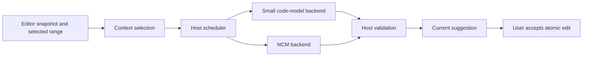

# Ringo-IDE

Ringo-IDE is an experimental development environment for responsive, local code
assistance. The first integration target is **a bounded completion for a selected
span of code**. A small code-model baseline and a Next-Concept Modeling (NCM)
backend will share the same host contracts, allowing comparison without
rewriting editor integration.

**Status: collaborator-ready reference scaffold, not a finished IDE or trained
NCM model.** You can run a deterministic example, validate exact edits, and run
the tests without a GPU, weights, API key, or runtime dependencies. The editor
UI, asynchronous worker transport/scheduler, and real inference remain work to
implement. This README is the entry point for joining that work.

## Start here

1. Run the [quickstart](#quickstart) and inspect its request/result JSON.
2. Check [what works today](#what-works-today) before choosing a task.
3. Read the [architecture](docs/ARCHITECTURE.md) for ownership and request flow.
4. For ML work, read the [NCM integration guide](docs/NCM_INTEGRATION.md).
5. Pick a bounded task from the [roadmap](docs/ROADMAP.md) and follow
   [CONTRIBUTING](CONTRIBUTING.md).

## Project scope

The intended interaction is: an editor captures a document snapshot, selects
prefix/suffix context, requests a completion, and shows a validated suggestion
only while that snapshot and request remain current. Accepting a suggestion
replaces only the host-selected range through the editor's undo system.
Rapid typing must supersede old work without blocking input.

| Workstream | Responsibility |
|---|---|
| Editor/host | Documents, context, coordinates, scheduling, ghost text, acceptance/undo |
| Local worker | Capability handshake, bounded messages, cancellation, model lifecycle |
| Completion backends | Small code-model baseline and experimental NCM adapter |
| Monitoring | Separate policy for ignoring, suggesting, or escalating events |
| Research/evaluation | Source fidelity, conditional NCM training, reproducible comparisons |

The UI framework, production host language, deployment device, and actual
model/checkpoint selection remain open. Python is the reference worker language;
it does not commit the editor to Python. Python code in the demo is an example,
not a declaration of model language support.

**Ringo-IDE and the Ringo harness are separate projects.** This repository holds
the IDE/worker scaffold. The Ringo executable harness reviews code and assesses
designs during development. It is outside the completion request path and is
not a runtime dependency or a Codex skill required by contributors.

## Quickstart

Use Python 3.11 or newer, from the repository root. For the current scaffold PR:

```sh
git clone --branch codex/ncm-worker-scaffold https://github.com/SkylerLK510/Ringo-IDE.git
cd Ringo-IDE
```

No installation or network access is required after cloning:

```sh
PYTHONPATH=src python3 -m ringo_ide demo
PYTHONPATH=src python3 -m unittest discover -s tests -v
python3 -m compileall -q src
```

The demo uses an in-memory `FixtureBackend` with a fixed answer. Its JSON contains
`before`, `request`, `result`, and `after`. The completed document is:

```python
def greet(name):
    return f"Hello, {name}!"
```

`backend` is `fixture` and `model_inference` is `false`. The example hashes the
complete document, inserts at a UTF-8 byte range, validates the identity and
payload, and returns edited text. It does not write files, start a worker
process, contact a provider, or measure model performance.

For an editable installation and the `ringo-ide` command:

```sh
python3 -m venv .venv
source .venv/bin/activate
python -m pip install -e .
ringo-ide demo
python -m unittest discover -s tests -v
```

The install may download build tooling; no model libraries are declared as
runtime dependencies. On Windows PowerShell activate with
`.venv\Scripts\Activate.ps1`, then use the installed commands above.

## What works today

| Component | Current state | Next deliverable |
|---|---|---|
| Package/CLI | Installable package; offline `demo` | Production worker entrypoint |
| Protocol | Typed requests, results, cancellation, capabilities | Validated JSONL codec and handshake |
| Exact edits | Snapshot hash/identity, UTF-8/CRLF range and payload checks; in-memory replacement | Live request/deadline checks and editor transaction |
| Fixture backend | Fixed answer, entry-time cancellation and close | Delayed/failing fixtures for asynchronous integration |
| Context | Snapshot/context records and provider interface | Bounded selection and editor coordinate mapping |
| Scheduler | Interface and one-active/one-pending policy | State machine, deadlines, cancellation, restart |
| Baseline model | `BaselineBackend` stub | Pinned prefix/suffix code-model adapter |
| NCM | `NcmBackend` stub and integration guides | Load/generate/reconstruct/decode reference adapter |
| Monitoring | `ignore`/`suggest`/`escalate` interface | Rules/LSP policy before learned decisions |
| Training/benchmarks | Documented boundaries and gates | Fidelity probe, replay runner, budgeted training |
| Verification | Offline tests; CI for Python 3.11–3.13 | Codec, scheduler and real-backend integration tests |

Baseline/NCM methods still raise `NotImplementedError`. Imports do not load
models or start processes. Example TOML is illustrative: there is no config
loader or device-support certification. The fixture is an integration aid, not
the small-model performance baseline. Dataclasses are in-process contracts,
not a validated wire schema.

## How NCM fits

NCM means **Next-Concept Modeling**. Its role here is an experimental producer of
a complete replacement span. The host retains source ownership, edit coordinates,
scheduling and monitoring. The pinned
[upstream research release](https://github.com/HazyResearch/ncm/tree/c70274273f489abc73832b2b98584a8483b6b203)
is a reference to investigate; its released tasks do not establish code
completion capability. See the [research evidence](docs/NCM_ARCHITECTURE_RESEARCH.md).



This is the target architecture; only the fixture-to-validation path executes
today. Within NCM the planned path is prompt tokenization → hierarchy generation
→ cumulative latent reconstruction → text decoding → `CompletionResult`.
Latent codes are not source text; intermediate refinements must not be displayed
as stable suggestions. The [integration guide](docs/NCM_INTEGRATION.md) maps this
to upstream modules, artifact requirements, device pitfalls and acceptance gates.

Implement shared host/worker infrastructure, then a real code-model baseline,
NCM reference compatibility, source-reconstruction fidelity, and conditional
code-generation research. Changing codebooks can require generator retraining.
No code-capable checkpoint, deployment speedup or training budget is assumed.
The [implementation research](docs/NCM_IMPLEMENTATION_METHODS.md) explains why.

## Repository map

```text
src/ringo_ide/
  __main__.py           Developer CLI
  demo.py               Offline request/result/edit example
  protocol/             In-process records, not a wire codec
  editor/context/       Snapshot and context-selection contracts
  editor/suggestions/   Future asynchronous scheduler contract
  monitoring/           Policy separate from generation
  workers/
    base.py             CompletionBackend/CancellationSignal protocols
    config.py           Configuration records, not a loader
    fixture/            Executable fixed-answer backend
    baseline/           Future small-code-model adapter
    ncm/                Future NCM adapter
  validation/           Snapshot/range/payload checks and in-memory application
tests/                  Offline behavior and documentation-link checks
.github/workflows/      Package, demo and test CI
configs/                Illustrative worker configuration
docs/                   Architecture, NCM integration, roadmap and research
research/ncm_training/  Future training boundary
benchmarks/completion/  Future model-comparison/replay boundary
```

## Joining the project

A useful first contribution is a tested bounded JSONL codec or host scheduler
using fixtures. Neither needs training or a GPU. For an ML contributor, begin
with an artifact manifest and a reference reconstruction probe. Files,
dependencies and completion criteria are in the [roadmap](docs/ROADMAP.md).

Before model/training work, agree on initial hardware, language, latency and
cancellation limits, memory ceiling, licensed data, artifact revisions and a
finite compute budget. These remain open. Research-note numbers are not
measurements of this scaffold. Keep weights, datasets, private source and run
outputs outside the repository. The project is [MIT licensed](LICENSE);
external model/data assets need their own license and revision records.
