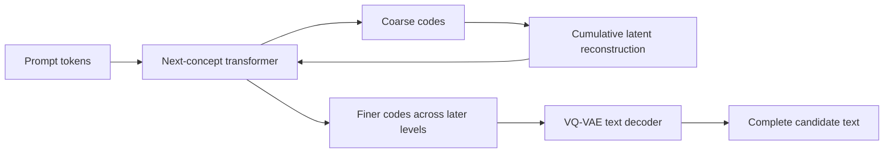

# Stanford Next-Concept Modeling for Ringo-IDE

Research date: October 23, 2026. Scope: feasibility research and proposed experiments; no NCM model inference, training, or IDE performance benchmark was performed for this report.

## Recommendation

**Investigate NCM as an optional local suggestion generator; retain the planned small-model monitor as a baseline until an IDE-specific comparison supports replacement.** NCM could make a complete block of output available quickly, which is attractive for code suggestions and short explanations. Its usefulness for monitoring, classification, or escalation is less obvious: those tasks may need only a score or a few output tokens. This is an engineering assessment, not a demonstrated NCM capability.

The central distinction is **architecture versus learned capability**. Next-Concept Modeling changes how a model represents and generates text. Installing the released research weights does not establish that the model understands source code, follows IDE instructions, performs fill-in-the-middle completion, or reliably decides when a stronger model is needed. The released task list covers summarization, translation, Sudoku, and unconditional text generation. [S2]

Ringo-IDE's [README](../README.md) describes a future 1.5B-parameter monitor. The checkout inspected at commit `40a0d0e` contains that README and a license as tracked files; three existing, untracked research documents describe token optimization and a latency pipeline. No implemented IDE/model interface or runnable application was found in the inspected file inventory. This report therefore proposes an integration boundary, rather than claiming compatibility with an existing implementation. Treat numerical claims in the older research documents as prior proposals requiring their own verification, not measurements reproduced here.

## What Stanford released

NCM means **Next-Concept Modeling**, from Stanford Hazy Research, with Together AI participation. The preprint appeared October 9, 2026; Stanford's explanatory post is dated October 12. It describes two training stages: learn a multiscale discrete representation of text, then freeze it and train a transformer to generate progressively finer representations. Nested dropout encourages useful coarse representations; corrupted conditioning codes improve robustness. [S1][S3]

The word *concept* denotes a learned latent code. Do not interpret the hierarchy as a reliable, human-readable plan or an inspectable reasoning trace. The implementation operates on vectors and codebook indices. [S4][S5]

The repository and checkpoint page identify MIT licensing. Preserve applicable notices when distributing derivatives; record the exact checkpoint and base tokenizer assets actually shipped. [S10][S11]

## How the architecture works

### Representation and training

The input still passes through an ordinary text tokenizer. For example, the XSum configuration uses GPT-2 tokenization, while WMT14 uses the Qwen3-0.6B tokenizer. These names identify tokenizers, not an embedded GPT-2 or Qwen language model used to generate the output. [S6][S8]

The VQ-VAE contains an encoder, a multiscale residual vector quantizer, and a decoder. During representation learning, token embeddings are quantized against level-specific codebooks. Each level adds a contribution to a cumulative reconstruction; later levels encode residual information left by earlier ones. The decoder maps the reconstructed latent sequence back to logits over ordinary text tokens. This is a learned reconstruction path, not reversible byte compression. [S5][S7]

The next-concept transformer conditions on a prompt and the resized cumulative reconstruction from previous levels. It predicts a level's code positions together, then proceeds to the next level. Thus the sequence of levels remains sequential even though positions within a level are predicted in parallel. The complete decode path crosses three interfaces: `generate` returns concatenated code indices; `idx_to_zhats` looks up each level's codebook vectors, upsamples nonfinal levels, applies residual transforms, and accumulates their contributions; the evaluator passes the final reconstruction to `tk.vqvae.decoder(zl[-1])` to obtain ordinary-token logits. Token selection, optional EOS truncation, and text detokenization produce the final candidate. Generated codes are therefore neither output tokens nor a finished suggestion. [S4][S5][S9]



This is an explanatory schematic, not the literal module graph. The prompt can use raw token embeddings in the published configurations; the whole prompt need not be encoded into a generated concept hierarchy. [S4][S6]

### Inference details that matter in an IDE

Level-zero handling varies by configuration: the code supports query-based generation, predicting initial codes from a prefix, and externally supplied initial codes. The inspected XSum configuration uses a query-based initial model pass followed by the loop over finer levels; an optional autoregressive level-zero path exists but is not enabled there. Consequently, counting only the finer-level loop understates this configuration's generator work. [S4][S6]

`generate` defaults to `use_kv_cache=False`, and the evaluator omits that argument. Its optional cache saves prefix KV, but `query_level0` explicitly rejects caching. This is not evidence of reusable generated-token state across edits: changing a bidirectionally encoded prefix can change its representations, and finer levels receive changing reconstructions. Cross-request cache reuse would need explicit validity rules and equivalence checks. Do not carry autoregressive prefix-cache performance claims into this backend without measurement. [S4][S9]

The reference evaluator can select final tokens with frequency and adjacency penalties using a position-by-position loop. This is postprocessing of decoder logits, not an additional transformer invocation per token, but it still contributes to latency. The generation API returns a finished code tensor rather than a stream of stable text tokens. [S9][S4]

## What the published evidence establishes

The following are **author-reported results**, not independent reproductions:

| Workload | Reported result against diffusion baselines |
|---|---|
| LM1B | Better generative perplexity; 21× faster wall-clock generation |
| OpenWebText | Comparable quality; 10× faster |
| XSum | Comparable ROUGE-L; 31× faster |
| Sudoku | Higher solve rates than tested autoregressive and diffusion baselines |

The Stanford post also reports 4–5× fewer training tokens. These are task-specific comparisons, not proof of equivalent reductions in training FLOPs or laptop latency. [S1]

The paper's timing setup uses an H100 SXM 80GB, batch size 16, and 1,024 generated sequences. Its LM1B scaling study reaches 725M generator parameters. [S3, §4.6 and Appendix C]

The tokenizer reports 99.99% exact token reconstruction on OpenWebText, with remaining errors involving names, numerals, and markup. That is not a code-fidelity guarantee. Fixed hierarchy schedules also impose work on short outputs. [S3, Appendices G and I]

**Assessment:** these results motivate an experiment in parallel generation. They do not establish code completion, repository reasoning, tool use, instruction following, calibrated monitoring, or an advantage over an optimized small autoregressive code model. Sudoku evidence does not resolve these gaps.

## Release audit and reproducibility gaps

Public source was inspected at commit `c70274273f489abc73832b2b98584a8483b6b203`. The source links below are pinned to that revision. Checkpoint metadata was inspected through the publisher's Hugging Face page; weights were not downloaded or executed. [S10]

| Item | Source inspection | Consequence for Ringo-IDE |
|---|---|---|
| XSum input/output | 512-token prompt; 48-token target; manual levels `4,6,10,14,20,26,32,40,48`; `query_level0: true` | This is a bounded summarizer configuration, not a general repository context window. [S6] |
| WMT14 input/output | 96-token prompt; 64-token target; eleven manual levels | A translation release cannot simply be prompted as a code assistant. [S8] |
| OpenWebText | One-token null prompt; 1,024-token target; 32 levels; 16 generator layers of width 1,024; 8,192-entry codebooks | Unconditional text generation does not demonstrate a useful IDE prompt interface. [S12] |
| LM1B large | One-token prefix; 128-token target; 36 layers of width 1,280; uncased BERT tokenizer | Do not assume source-code case or identifiers survive this text preprocessing. [S13] |
| Runtime | `evaluate.py` enumerates CUDA devices; shard script uses `.cuda()` and CUDA tensors | CPU/Metal deployment requires a port and validation; no such validation was performed here. [S14][S9] |
| Distribution | Paired `generator.pt` and `tokenizer.pt`; custom PyTorch classes; requirements include PyTorch and Transformers | Budget both components and a runtime; a standard decoder-only model loader is insufficient. [S2][S15] |

There are **paper/release differences**. Appendix C describes XSum with eight levels, while its released configuration lists nine. For OpenWebText, the paper specifies 12 layers, width 768, and 4,096-entry codebooks; the inspected release uses 16, 1,024, and 8,192. [S3][S6][S12]

These differences may reflect release revisions or conventions, but their causes were not established. Do not silently label released checkpoint performance as an exact reproduction of the paper. Before benchmarking, pin source and checkpoint revisions, confirm the intended configuration with the checkpoint, use strict state-dictionary loading, count actual evaluations, and record loaded parameter counts and precision.

The inspected source tree contains model definitions and evaluation scripts, but no complete training entry point was found. A code-domain NCM training recipe is therefore additional work, not a documented one-command path in this release. The [source tree](https://github.com/HazyResearch/ncm/tree/c70274273f489abc73832b2b98584a8483b6b203) is the evidence for that bounded observation.

## Could it replace the embedded small LLM?

The answer depends on what “monitor” must do. The following is a proposed fit assessment, not published NCM benchmark coverage:

| Intended local job | Assessment | Better first comparison |
|---|---|---|
| Classify an edit, trigger escalation, or rank retrieved context | NCM's generation hierarchy may add work without helping the output | Rules, a compact encoder/classifier, and the planned small LLM |
| Generate a complete multiline suggestion | Strongest reason to explore parallel generation; exact symbols and suffix constraints remain central risks | Small code model with fill-in-the-middle support |
| Explain a diagnostic or summarize a code region | Plausible bounded-generation task; natural-language summarization weights are only a starting point | Same-input small model at equal quality and latency |
| General coding chat, planning, or tool control | No supporting capability evidence in the inspected release | Existing capable coding model and explicit tool interfaces |
| Compress repository memory | Learned codes are not lossless records or automatically searchable embeddings | Raw source plus an independently evaluated retrieval index |

NCM remains a transformer-based language-generation system. Replacing next-token generation changes the inference structure; it does not by itself remove the need for training data, quality controls, or sufficient capacity. Do not choose parameter count as the sole definition of a suitable embedded model.

### Memory accounting

Use `weight_bytes ≈ (generator_parameters + retained_tokenizer_parameters) × bits_per_weight / 8`, then add activations, codebooks or buffers not already counted, attention state, decoder logits, runtime overhead, and any duplicate copies. Count unique loaded tensors to avoid counting shared weights twice. This is a planning formula, not measured resident memory.

For illustration, **a hypothetical** 100M generator plus 60M retained tokenizer needs about 320 MB of 16-bit weights, or an idealized 80 MB at 4 bits. A hypothetical 1.5B model needs about 3.0 GB or 750 MB respectively. Decimal units are used. These arithmetic examples do not assert the released NCM supports 4-bit execution or preserves quality after quantization. Whole-tokenizer loading may retain training-only components; removing them also needs validation.

The deployment question is whether the complete NCM system produces useful results within the target device's memory, energy, and latency budget. Parameter-count comparisons across different tasks cannot answer that.

### Latency accounting

For a fair comparison, measure **time to a usable suggestion**:

```text
NCM = input preparation + initial-code handling
    + sum(level generation + reconstruction work)
    + final text decoding + validation + UI delivery

Autoregressive = input preparation + prompt processing
              + token generation + validation + UI delivery
```

An autoregressive model may display a useful prefix early. An NCM candidate can change across refinement levels, so proposed IDE behavior should wait for a validated final candidate before displaying ghost text. Measure complete-suggestion latency alongside time to first usable text; tokens per second alone makes these interfaces hard to compare.

Long prompts may dominate either backend. NCM's short coarse levels do not imply that repeatedly attending to a large prompt becomes free. Likewise, fewer sequential model evaluations do not imply proportionally less total arithmetic or memory traffic.

For a one-token decision or a short completion, the inspected generation loop still traverses its configured hierarchy and the evaluator decodes the final target grid before optional EOS truncation. Truncating displayed text does not recover that computation. Initial-code handling, final decoding, postprocessing, and worker communication can therefore outweigh any benefit from parallel positions. Measure these costs separately for short outputs instead of extrapolating from full-length throughput. This is an engineering inference from the release path, not a measured crossover point. [S4][S6][S9]

## Proposed Ringo-IDE integration

Keep the model behind a replaceable local worker boundary. This is a proposal, not implemented code:

```text
Editor events → syntax/context selection → bounded request scheduler
                                         → local worker: baseline OR NCM
                                         → parse/type/format checks
                                         → current-version suggestion
                                         → optional escalation
```

Give requests a task kind, document version, cursor location, prefix/suffix context, output budget, and deadline. Give responses a complete candidate, matching version, timing, backend revision, and explicit cancellation/timeout status. Do not invent a confidence score from uncalibrated code probabilities.

Use a latest-request policy and bounded queue. The released `generate` method has no cancellation callback or token stream, so cancellation checks between hierarchy stages would require adapting its loop; a wrapper alone can discard results but cannot provide those internal checks. Proposed worker behavior should distinguish completed, cancelled, timed-out, and failed requests, and discard stale document versions before display. On loading, decoding, or validation failure, return an explicit failure without applying an edit; any baseline fallback must respect the same deadline and document version. A cancellation flag does not guarantee immediate interruption of an already dispatched GPU operation. Record cancellation latency instead of inheriting the old pipeline document's proposed millisecond values. [S4][S9]

Preserve source bytes outside the model. Send the selected context as conditioning input; apply generated edits only to the intended range after validation. A reconstructed latent sequence should never become the canonical copy of an unchanged file, identifier, path, or diagnostic.

For a first prototype, a separate Python worker is a reasonable way to learn about compatibility. A production local bundle would require a deliberate CPU/Metal/CUDA strategy, offline assets, startup and crash handling, and an audited tensor export/quantization path. The inspected custom PyTorch implementation does not establish a ready-made GGUF, MLX, Core ML, ONNX, or llama.cpp deployment path. This is a statement about the inspected release, not an ecosystem-wide absence claim.

## Proposed experiment and decision gates

No experiment below has been run. These are proposed follow-up tasks, not an evaluation or improvement campaign launched by this research.

1. **Define the monitor's contract.** Separate classification, suggestions, explanations, and escalation. Specify supported devices and languages. Keep a no-generative-model baseline for classification.
2. **Verify the release.** Pin source, model revisions, tokenizer assets, and config hashes. Reproduce one released conditional task first to check loading and decoding. Record actual evaluation count, precision, and both model components. Resolve or document paper/config differences before claiming reproduction.
3. **Test source fidelity before training a generator.** Round-trip representative source through candidate tokenizers, including case, indentation, tabs, Unicode identifiers, long numeric literals, paths, JSON, and rare API names. Report token, byte, identifier, and whole-span exact match separately. Ordinary prose reconstruction accuracy is insufficient. Reject tokenizers that erase case or normalization distinctions needed by the chosen languages.
4. **Build an IDE-specific candidate.** Use properly licensed code/context/target pairs and an explicit prefix–suffix completion format. Compare reusing a tokenizer with retraining both representation and generator; retrain the generator if the latent vocabulary changes. Treat a new code-capable NCM as a training project, not a checkpoint setting.
5. **Compare on the same device and workload.** Use batch size one, identical available context, matched output budgets, and a warmed baseline; report cold startup separately. Split examples by repository and time to limit leakage. Test short and multiline edits, cursor moves, rapid typing, cancellation, and background load. Agree on data/compute budgets before starting.

Suggested measurements:

| Dimension | Record |
|---|---|
| User-visible latency | p50/p95/p99 time to usable text and complete validated suggestion; cold start |
| Quality | Parse/type success, execution tests where applicable, exact identifiers, completion acceptance/edit distance |
| Monitoring | Precision/recall and missed-escalation rate at the selected operating point |
| Resources | Peak process/GPU memory, energy per useful suggestion, sustained thermal behavior |
| Responsiveness | Stale display rate, cancellation delay, wasted work, UI stalls |
| Reproducibility | Source/checkpoint/config hashes, hardware, precision, sample count, uncertainty |

Suggested adoption gate: NCM must meet a predeclared quality floor while improving useful-suggestion latency or energy under the target memory limit. Compare with the optimized small-model baseline and the simpler classifier where relevant. Require unchanged source outside the edit span and no stale suggestions in the cancellation suite. Numerical thresholds should be set from product requirements before the experiment; the old document's sub-20-ms target is not an observed NCM result.

**Decision today:** preserve NCM as a candidate architecture. Its most compelling Ringo-IDE use is bounded parallel generation; a replacement for the monitor is conditional on defining that role and demonstrating better results on its actual workload.

## Sources and verification boundary

Only primary research, publisher metadata, public implementation, and the local Ringo-IDE checkout were used as evidence. Paper/blog performance is author-reported. Code behavior was inspected statically. No checkpoints, CPU/Metal ports, quantized exports, training runs, or target-device performance were validated. The recommendations, illustrative arithmetic, integration boundary, and experiment gates are this report's engineering proposals.

- **S1:** [Stanford Hazy Research announcement, October 12, 2026](https://hazyresearch.stanford.edu/blog/2026-10-12-ncm).
- **S2:** [NCM release README](https://github.com/HazyResearch/ncm/blob/c70274273f489abc73832b2b98584a8483b6b203/README.md).
- **S3:** [NCM paper, arXiv:2610.14162v1](https://arxiv.org/html/2610.14162v1), especially §4.6 and Appendices C, G, I.
- **S4:** [Generator and inference implementation](https://github.com/HazyResearch/ncm/blob/c70274273f489abc73832b2b98584a8483b6b203/models/next_concept.py), including `generate`.
- **S5:** [Residual quantizer and reconstruction](https://github.com/HazyResearch/ncm/blob/c70274273f489abc73832b2b98584a8483b6b203/models/quant.py).
- **S6:** [Released XSum evaluation configuration](https://github.com/HazyResearch/ncm/blob/c70274273f489abc73832b2b98584a8483b6b203/config/eval/xsum.yaml).
- **S7:** [VQ-VAE implementation](https://github.com/HazyResearch/ncm/blob/c70274273f489abc73832b2b98584a8483b6b203/models/vqvae.py).
- **S8:** [Released WMT14 evaluation configuration](https://github.com/HazyResearch/ncm/blob/c70274273f489abc73832b2b98584a8483b6b203/config/eval/wmt14.yaml).
- **S9:** [Evaluation shard, decoding, and CUDA placement](https://github.com/HazyResearch/ncm/blob/c70274273f489abc73832b2b98584a8483b6b203/scripts/eval_shard.py).
- **S10:** [Publisher checkpoint metadata and XSum config](https://huggingface.co/hazyresearch/ncm-checkpoints/blob/main/xsum/config.yaml). The inspected page shows revision `7100573` and MIT metadata; full weight provenance/loading was not verified.
- **S11:** [Repository MIT license](https://github.com/HazyResearch/ncm/blob/c70274273f489abc73832b2b98584a8483b6b203/LICENSE).
- **S12:** [Released OpenWebText evaluation configuration](https://github.com/HazyResearch/ncm/blob/c70274273f489abc73832b2b98584a8483b6b203/config/eval/owt.yaml).
- **S13:** [Released LM1B large evaluation configuration](https://github.com/HazyResearch/ncm/blob/c70274273f489abc73832b2b98584a8483b6b203/config/eval/lm1b-large.yaml).
- **S14:** [Evaluation entry point](https://github.com/HazyResearch/ncm/blob/c70274273f489abc73832b2b98584a8483b6b203/evaluate.py).
- **S15:** [Runtime requirements](https://github.com/HazyResearch/ncm/blob/c70274273f489abc73832b2b98584a8483b6b203/requirements.txt).
